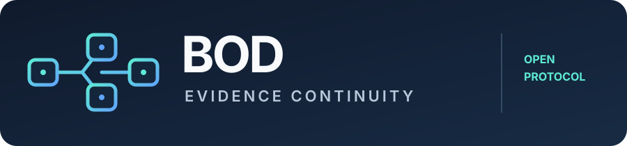

<div align="center">
  

  # BOD — Evidence Continuity

  **Portable, independently verifiable history for software release evidence.**

  BOD links project-state checkpoints and release evidence across time — preserving predecessor relationships, exposing forks, and carrying selected evidence payloads into a verifiable recovery bundle.

  [Quickstart](docs/GETTING_STARTED.md) · [Architecture](docs/ARCHITECTURE_OVERVIEW.md) · [Verification experiment](docs/VERIFICATION_EXPERIMENT.md) · [Evidence Bundle specification](docs/EVIDENCE_BUNDLE_v0.1.md)

  [](https://github.com/BogdanXI/Blockchain-BOD/actions/workflows/ci.yml)
  [](LICENSE)
  [](pyproject.toml)
  [](docs/EVIDENCE_BUNDLE_v0.1.md)
  [](docs/PROJECT_STATUS.md)
</div>

---

## The engineering problem

A software release is supported by more than a Git commit. Its evidence may include build provenance, SBOMs, signatures, vulnerability results, deployment records and attestations. These objects are produced by different tools and retained in different systems.

That fragmentation makes a specific question difficult to answer later:

> **Can an independent operator reconstruct and verify which project state and evidence belonged to a release, how that state followed its predecessor, and whether the evidence bytes are still available — without depending on the original CI service?**

BOD explores a small, composable layer for that problem. It does not replace Git, SLSA, in-toto, Sigstore, SPDX, CycloneDX, or an evidence store. It records deterministic state commitments, links successive evidence states, and provides a portable package for the evidence bytes explicitly included in it.

## What is implemented

| Capability | Current implementation |
|---|---|
| Deterministic project state | Git-tracked file manifest with content digests |
| Evidence continuity | Versioned envelopes with predecessor references |
| Branch-aware history | Graph verification reports forks and heads without choosing a canonical head |
| Portable recovery | Evidence Bundle v0.1 carries referenced payload bytes and a checkpoint; verified extraction writes digest-named files and a manifest |
| Independent verification | Separate verifier and CLI checks for integrity, completeness and lineage |
| Evidence format inspection | Structural inspection for in-toto, SLSA, DSSE, CycloneDX and SPDX |
| Signature verification | Delegation to the official `sigstore-python` tooling |
| Optional Ethereum witness | Permissionless append-only checkpoint registry; commitments only |
| EAS integration tooling | Schema and linked-attestation scripts; live registration has not been performed |

See the [technical overview](docs/ARCHITECTURE_OVERVIEW.md) for component boundaries and the [project status](docs/PROJECT_STATUS.md) for the complete implementation and non-claims register.

## A recovery experiment with real CI evidence

A public GitHub Actions run was used to test whether release evidence could be recovered and checked after the original local evidence copies were removed.

<div align="center">

| Snapshot | Recovered payloads | Payload bytes | Sigstore result |
|---:|---:|---:|---|
| 108 tracked files | 2 | 17,349 | **VALID** |

</div>

The experiment packaged a CycloneDX SBOM and a Sigstore bundle, deleted the original local evidence directory, extracted both payloads from the BOD bundle, verified bundle integrity, inspected the SBOM (37 components), and verified the Sigstore bundle offline against the expected GitHub workflow identity.

This demonstrates one concrete recovery path. It does **not** establish broad interoperability, prove SBOM correctness, or show that BOD outperforms existing systems. Offline Sigstore verification used a local trust root; trust metadata freshness remains an operator responsibility.

**Reproduce / inspect:** [experiment record](docs/VERIFICATION_EXPERIMENT.md) · [CI workflow](.github/workflows/ci.yml) · [latest workflow runs](https://github.com/BogdanXI/Blockchain-BOD/actions/workflows/ci.yml)

## How the pieces fit

```text
  SOURCE REPOSITORY                 EXISTING EVIDENCE TOOLS
  Git-tracked project state         SLSA · in-toto · Sigstore
             │                      SPDX · CycloneDX · CI
             └──────────────┬──────────────────┘
                            ▼
                 DETERMINISTIC CHECKPOINT
                 state root · evidence refs
                 predecessor · sequence
                            │
                            ▼
                  CONTINUITY / LINEAGE
                  integrity · graph · forks
                            │
                 ┌──────────┴──────────┐
                 ▼                     ▼
          PORTABLE BUNDLE        OPTIONAL ETHEREUM
          checkpoint + bytes     compact commitment
          offline verification  public timestamped witness
```

The portable verification path does not require a wallet, token, RPC endpoint or BOD-operated service. Ethereum is an optional publication layer, not a dependency of the continuity core. Evidence payloads remain off-chain.

## Quickstart

Requirements: Python 3.11 or newer.

```bash
git clone https://github.com/BogdanXI/Blockchain-BOD.git
cd Blockchain-BOD
python -m pip install --editable ".[test,lint]"
bod demo
```

Capture and verify a repository checkpoint:

```bash
bod capture . --project my-project --out checkpoint.json
bod verify checkpoint.json --portable
python scripts/independent_verify.py checkpoint.json
```

Verify a collection of checkpoints as a graph, retaining visible forks rather than selecting a preferred branch:

```bash
bod verify checkpoints.json --portable --graph
python scripts/independent_verify.py checkpoints.json --graph
```

Create, verify and recover a self-contained evidence bundle:

```bash
bod capture . --project my-project --evidence evidence-refs.json --out checkpoint.json
bod bundle-create checkpoint.json --payload <sha256-hex>=./provenance.json --out release-evidence.bundle.json
bod bundle-verify release-evidence.bundle.json
bod bundle-extract release-evidence.bundle.json --out-dir recovered-evidence
```

Extraction verifies the bundle first, writes digest-named payload files and a mapping manifest, and refuses to overwrite an existing destination directory. See the [Evidence Bundle specification](docs/EVIDENCE_BUNDLE_v0.1.md).

Run the local checks:

```bash
python scripts/validate_public_surface.py
ruff check --select E4,E7,E9,F src scripts tests
python -m pytest -q
```

The optional Ethereum contract tests use [Foundry](https://getfoundry.sh/):

```bash
forge test -vvv
```

For the complete installation and safety notes, see [Getting Started](docs/GETTING_STARTED.md).

## Design boundaries

- **No new evidence format mandate.** BOD references existing evidence rather than redefining provenance or SBOM semantics.
- **No canonical-head authority.** Forks remain visible; verification does not silently decide which branch is authoritative.
- **No on-chain payload storage.** Ethereum records compact commitments, not source code, logs, SBOMs, secrets or personal data.
- **No hosted-service dependency.** Local capture, bundle verification and independent checks are designed to run without a BOD server.
- **No claim of semantic truth.** A matching digest establishes byte identity relative to a digest. It does not prove that a build was safe, a statement was truthful, or an SBOM was complete.

## Relationship to the ecosystem

BOD is intended to compose with established tools, not displace them. Chainloop and Kosli provide evidence-management capabilities; Archivista stores and exposes in-toto attestations; GUAC aggregates supply-chain metadata; Git, SLSA, in-toto and Sigstore provide foundational source, provenance and transparency functions. BOD's hypothesis is narrower: portable, predecessor-linked continuity and recovery across successive evidence states.

That differentiation remains a hypothesis until a reproducible, side-by-side evaluation demonstrates a material operational advantage. See the [competitive landscape](docs/COMPETITIVE_LANDSCAPE.md) and [product differentiation](docs/PRODUCT_DIFFERENTIATION.md).

## Ethereum integration status

The repository includes a minimal append-only Solidity checkpoint registry, Foundry tests, and EAS client tooling. The contract has no owner-controlled upgrade path, token, staking mechanism or canonical-head pointer.

**No Ethereum or Sepolia deployment is claimed. No EAS schema has been registered. No live attestation has been issued. The contract has not undergone an independent security audit.** Local tests are not an audit or a production-readiness claim.

Details: [Ethereum integration](docs/ETHEREUM_INTEGRATION.md) · [EAS integration](docs/EAS_INTEGRATION.md)

## Maturity and security

**Status: experimental public engineering prototype — not production-secure.**

The current evidence supports a working local prototype, a GitHub Actions/Sigstore recovery scenario and a recovery test using a real Reth v2.11.0 release asset. These tests do not yet support claims of production readiness, market demand, paying customers, broad interoperability or superiority over existing products. The next validation gate is a reproducible comparative benchmark and independent operator feedback.

Review the [threat model](docs/THREAT_MODEL_v0.1.md), [privacy model](docs/PRIVACY_MODEL.md), [security policy](SECURITY.md), [reproducibility policy](docs/REPRODUCIBILITY.md), and [roadmap](docs/ROADMAP.md) before using the prototype with sensitive or production data.

## Repository map

```text
src/                    Python reference implementation and CLI
protocol/               Ethereum checkpoint registry and historical protocol material
scripts/                Independent verifier and experiments
tests/                  Python regression and recovery tests
test/                   Foundry contract tests
tools/eas/              EAS integration scripts
docs/                   Architecture, security, formats and experiment records
research/               Architecture decisions
```

## Contributing

Issues and focused pull requests are welcome. Please include a reproducible scenario, expected behavior, observed behavior and relevant test coverage. See [CONTRIBUTING.md](CONTRIBUTING.md).

## License

MIT — see [LICENSE](LICENSE).
